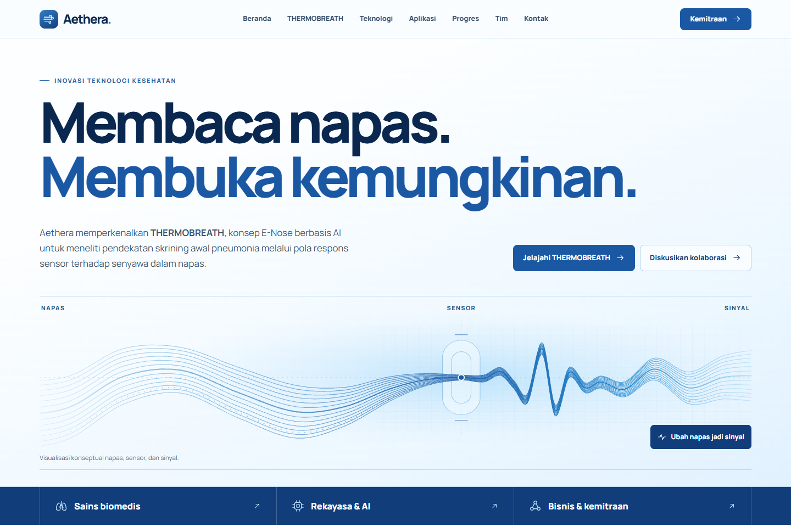
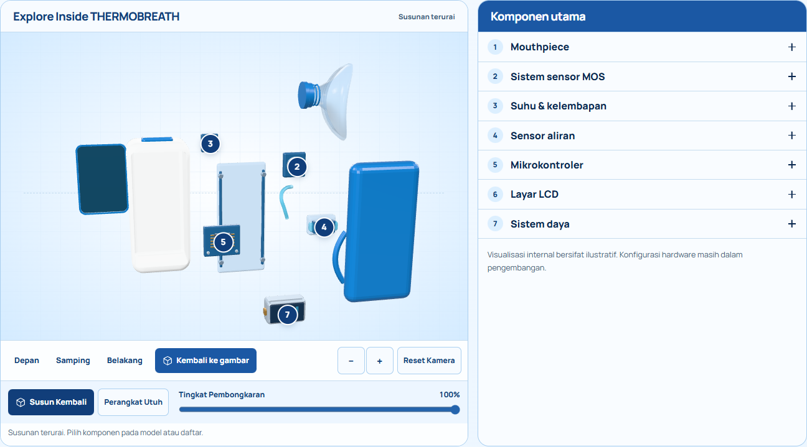

<p align="center">
  
</p>

<h1 align="center">Aethera × THERMOBREATH</h1>

<p align="center"><strong>Membaca napas. Membuka kemungkinan.</strong></p>

<p align="center">
  Landing page interaktif untuk mengenal rancangan E-Nose portabel THERMOBREATH<br>
  dan riset Aethera tentang pola respons sensor pada hembusan napas.
</p>

<p align="center">
  <a href="#mulai-cepat">Mulai cepat</a> &nbsp;·&nbsp;
  <a href="#jelajahi-situs">Jelajahi situs</a> &nbsp;·&nbsp;
  <a href="#struktur-proyek">Struktur proyek</a> &nbsp;·&nbsp;
  <a href="#pengujian">Pengujian</a>
</p>



## Mulai cepat

Siapkan **Git**, **Node.js 22+**, dan **Python 3**. Build memakai modul bawaan Node.js, jadi perintah `npm install` dapat dilewati.

```bash
git clone https://github.com/hanif-12-01/THERMOBREATH-Maketing-web.git
cd THERMOBREATH-Maketing-web
npm run build
npm run preview
```

Buka [beranda lokal](http://127.0.0.1:4173/) atau langsung ke [penjelajah THERMOBREATH](http://127.0.0.1:4173/#thermobreath). Jalankan kembali `npm run build` setelah mengubah source. Hasil build statis tersedia di `dist/`.

## Jelajahi situs

| Bagian | Yang bisa dicoba |
| :--- | :--- |
| **Napas → sensor → sinyal** | Gerakkan kursor atau sentuh ilustrasi di beranda untuk mengikuti visualisasi napas dan respons sensor. |
| **Penjelajah perangkat 3D** | Pilih **Buka model 3D** untuk memutar dan memperbesar perangkat, memilih sudut kamera, serta menggeser kontrol pembongkaran dari 0 hingga 100%. |
| **Inspeksi komponen** | Pilih bagian lewat model, penanda, atau daftar komponen. Saat WebGL atau model tak tersedia, detail tetap bisa dijelajahi lewat poster dan daftar. |
| **Teknologi dan sains** | Ikuti lima tahap dari pengambilan sampel hingga penyajian informasi. Buka panel Accuracy untuk melihat benchmark tiga metode klasifikasi pada sembilan kategori S-OH. |



**Tampilan lainnya** &nbsp; [Model utuh](docs/qa/web-3d-001-assembled.png) &nbsp;·&nbsp; [Inspeksi komponen](docs/qa/web-3d-001-selected.png) &nbsp;·&nbsp; [Ponsel](docs/qa/web-3d-001-mobile.png) &nbsp;·&nbsp; [Mode poster](docs/qa/web-3d-001-fallback.png)

> **Status riset**
>
> THERMOBREATH masih pada tahap konsep. Susunan internal bersifat ilustratif dan layar LCD menampilkan simulasi. Benchmark S-OH menilai klasifikasi sembilan kategori pada data tanpa label pneumonia. Kemampuan skrining pneumonia memerlukan validasi klinis tersendiri.

## Struktur proyek

Situs dibangun dengan **HTML, CSS, dan JavaScript**. Node.js menghasilkan halaman statis, sementara `<model-viewer>` dan GLB baru dimuat saat penjelajah 3D dibuka.

| Lokasi | Isi |
| :--- | :--- |
| [`src/`](src/) | Markup dan konten, gaya responsif, interaksi beranda, penjelajah 3D, dan metadata perakitan. |
| [`public/models/`](public/models/) | Dua model GLB, termasuk model konseptual dengan 11 grup beranimasi. |
| [`public/research/soh-baseline.json`](public/research/soh-baseline.json) | Ringkasan agregat benchmark S-OH pada 1.234 sampel dengan evaluasi stratifikasi 5 fold. |
| [`docs/3d/`](docs/3d/) | File Blender yang dapat diedit dan [panduan menyiapkan aset untuk web](docs/3d/BLENDER_TO_WEB_ASSET_GUIDE.md). |
| [`scripts/`](scripts/) · [`docs/qa/`](docs/qa/) | Build, ekspor aset, skrip pengujian, serta tangkapan layar dan hasil QA. |

Lisensi dependensi yang disertakan tersedia untuk [model-viewer](public/vendor/model-viewer.LICENSE) dan [font Manrope](public/fonts/manrope.OFL.txt).

## Pengujian

```bash
npm run lint
node --test scripts/explosion.test.mjs
npm run build
```

Hasil Lighthouse pada preview lokal tercatat di [laporan JSON](docs/qa/web-3d-001-lighthouse-results.json).

| Profil | Performa | Aksesibilitas | CLS |
| :--- | ---: | ---: | ---: |
| Desktop | 100 | 100 | 0 |
| Ponsel (emulasi) | 99 | 100 | 0 |

[Pengujian penjelajah 3D di browser](docs/qa/web-3d-001-browser-results.json) mencakup lima lebar layar, input sentuh dalam emulasi, kontrol kamera, perakitan ulang, serta fallback tanpa WebGL atau JavaScript.
